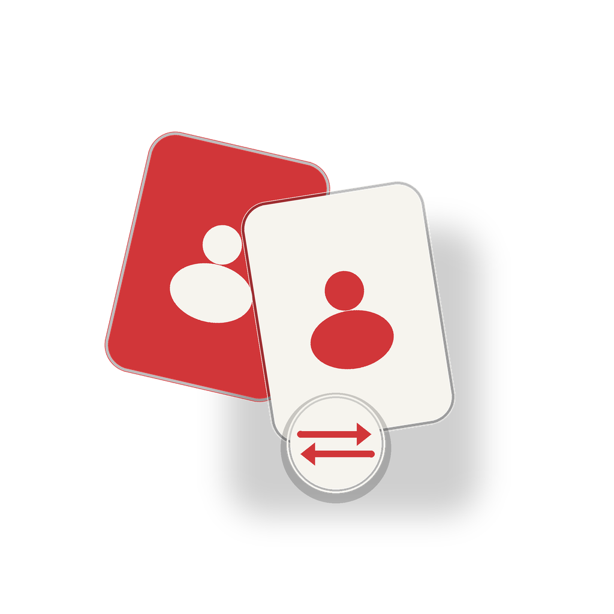

# RiotSwitch

[](https://github.com/quentingimenez/RiotSwitch/actions/workflows/ci.yml)

<p align="center"></p>

RiotSwitch garde plusieurs comptes Riot Games connectés et permet de passer de l'un à l'autre depuis un petit overlay attaché au Riot Client, sans se déconnecter et se reconnecter à la main.

> Projet personnel, non officiel et non affilié à Riot Games. À utiliser avec tes propres comptes, sur ta propre machine. Lis l'avertissement en bas de page avant utilisation.

## Ce que fait RiotSwitch

- Affiche un bouton discret dans le coin supérieur droit de la fenêtre du Riot Client.
- Ouvre un panneau listant les comptes enregistrés, avec le compte actuellement connecté.
- Ajoute le compte courant au coffre en un clic (« + Ajouter le compte actuel »).
- Réordonne les comptes enregistrés (▲/▼ ou tri A → Z) ; l'ordre est partagé avec l'overlay.
- Change de compte en un clic : fermeture propre du Riot Client, remplacement du fichier de session, relance, puis vérification du compte réellement connecté via l'API locale du client. Si la session enregistrée a expiré, le client reste sur l'écran de connexion : RiotSwitch ne rebascule pas de force sur l'ancien compte.
- Fonctionne sans mot de passe : seuls les fichiers de session Riot sont conservés, chiffrés avec DPAPI (utilisateur Windows courant).
- Ne modifie jamais les exécutables, l'asar, la configuration d'installation ou les fichiers de paramètres du Riot Client.
- Refuse de changer de compte pendant une partie en cours (League of Legends, VALORANT, etc.).

## Comment ça marche

Le Riot Client garde la session « rester connecté » dans un seul fichier :

```
%LOCALAPPDATA%\Riot Games\Riot Client\Data\RiotGamesPrivateSettings.yaml
```

RiotSwitch capture ce fichier **entier** par compte, le chiffre et le stocke dans son coffre. Pour changer de compte, il :

1. vérifie qu'aucune partie n'est en cours ;
2. ferme proprement l'interface du Riot Client (les jetons de session sont alors écrits sur disque) ;
3. capture la session du compte courant, au cas où le client aurait fait tourner les jetons depuis la dernière capture ;
4. arrête le service Riot, écrit atomiquement le fichier de session du compte cible ;
5. relance le service Riot Client ;
6. attend l'apparition de la fenêtre et vérifie via l'API locale (`/rso-auth/v1/authorization`) que le compte connecté est bien celui demandé ;
7. en cas d'échec :
   - si le client a ouvert **un autre compte** que la cible, restaure la sauvegarde précédente et relance le client (rollback) ;
   - si **aucun compte** n'est confirmé (session cible expirée ou révoquée), laisse le client ouvert sur l'écran de connexion, sans revenir au compte précédent : reconnecte-toi avec ce compte, puis ajoute-le à nouveau.

Aucune donnée de session ne part sur Internet : la seule communication réseau locale est une requête HTTPS vers `127.0.0.1`, sur le port du lockfile du Riot Client. La vérification des mises à jour interroge uniquement l'API publique GitHub Releases (voir « Mises à jour »).

## Prérequis

- Windows 10 ou 11 en 64 bits.
- Riot Client installé (League of Legends, VALORANT, etc.).
- .NET 8 Desktop Runtime (ou le SDK .NET 8 pour compiler). Le binaire publié est framework-dependent.
- Être connecté à chaque compte au moins une fois pour l'enregistrer dans le coffre.

## Installation

### Depuis GitHub Releases (recommandé)

Télécharge `RiotSwitch-win-x64.zip` depuis la dernière [release GitHub](https://github.com/quentingimenez/RiotSwitch/releases), vérifie le fichier `.sha256` fourni, puis extrais l'archive dans un dossier stable (par exemple `%LOCALAPPDATA%\Programs\RiotSwitch`) et lance `RiotSwitch.exe`. Le binaire est framework-dependent : le [.NET 8 Desktop Runtime](https://dotnet.microsoft.com/download/dotnet/8.0) doit être installé.

Les releases sont construites automatiquement par GitHub Actions à chaque tag `v*` : archive `RiotSwitch-win-x64.zip` + empreinte SHA-256.

### Installateur Windows

Chaque release fournit **`RiotSwitch-Setup-x64.exe`** : installation par utilisateur (aucun droit administrateur), raccourcis dans le menu Démarrer, désinstalleur propre et conservation de tes comptes/sauvegardes dans `%LOCALAPPDATA%\RiotSwitch` lors d'une désinstallation.

L'installateur vérifie la présence de **.NET 8 Desktop Runtime (x64)** et propose la page de téléchargement s'il manque. Il ferme proprement un éventuel veilleur RiotSwitch avant de remplacer les fichiers.

### Exécutable autonome (sans installation)

Chaque release fournit aussi **`RiotSwitch-win-x64.exe`**, un exécutable autonome d'environ 64 Mo : il embarque le runtime .NET, donc **aucune installation du .NET 8 Desktop Runtime n'est nécessaire**. Télécharge-le, vérifie le `.sha256` associé et lance-le directement.

Cette variante portable ne propose pas l'auto-update (pour mettre à jour, retélécharge l'exécutable depuis la dernière release) ; l'auto-update reste disponible pour l'installation en dossier issue du zip.

### Depuis la CI (build récent)

Chaque push sur `main` produit aussi un artefact téléchargeable, sans attendre une release :

1. Ouvre l'onglet **Actions** → dernier run **CI** vert.
2. En bas du résumé du run, télécharge l'artefact **RiotSwitch-win-x64** (dossier complet) ou **RiotSwitch-win-x64-singlefile** (exécutable autonome seul).
3. Pour l'artefact dossier, extrais l'archive : `RiotSwitch.exe` se trouve à la racine, avec ses dépendances et le CLI dans `cli/`. L'artefact singlefile contient directement `RiotSwitch.exe`.

L'artefact CI est conservé 14 jours et n'est pas signé comme une release ; pour une installation durable, préfère l'archive de release ci-dessus.

### Depuis les sources

```powershell
cd riot-switcher
powershell -ExecutionPolicy Bypass -File tools\publish.ps1
```

Le dossier `dist\` contient `RiotSwitch.exe`, ses dépendances, le CLI dans `dist\cli\` et ce README. Copie le dossier `dist` où tu veux (par exemple `%LOCALAPPDATA%\Programs\RiotSwitch`) et lance `RiotSwitch.exe`.

### Premier lancement

1. Lance `RiotSwitch.exe`. L'assistant de premier lancement s'ouvre.
2. Choisis le mode :
   - **Veilleur en arrière-plan (par défaut)** : RiotSwitch reste discret en mémoire (aucune fenêtre), démarre avec Windows et affiche l'overlay dès que la fenêtre du Riot Client apparaît. Il est optimisé pour rester très léger : WorkingSet d'environ 10–16 Mo au repos après compactage (privé ≈ 14–16 Mo) et CPU quasi nul (≈0,3 % d'un cœur en mesure précise, 0 % affiché dans le Gestionnaire des tâches).
   - **Zéro fond** : RiotSwitch ne tourne pas tant que le Riot Client n'est pas lancé. Le raccourci « Riot Client (Switch) » démarre le Riot Client et le veilleur ensemble ; le veilleur quitte avec le Riot Client. **Important :** si tu lances le Riot Client par son raccourci habituel, RiotSwitch ne démarre pas et l'overlay n'apparaît pas.
3. Ouvre le Riot Client et connecte-toi au premier compte.
4. Clique sur le bouton ⇄ en haut à droite, puis sur « + Ajouter le compte actuel ».
5. Déconnecte-toi, connecte-toi au second compte, puis ajoute-le de la même façon.
6. Les deux comptes apparaissent dans le panneau : un clic suffit pour basculer.

> Le premier ajout doit être fait depuis chaque compte, une fois connecté. RiotSwitch ne peut pas fabriquer une session à partir d'un mot de passe : il capture la session existante.

## Utilisation

### Overlay

- Bouton replié : petit carré arrondi en haut à droite de la fenêtre du Riot Client (déplaçable, sans jamais sortir de la fenêtre du client).
- Panneau : compte actuel, liste des comptes, dates de dernière utilisation, bouton « + Ajouter », « Paramètres » et « Actualiser ».
- Ordre des comptes : Paramètres → « Comptes enregistrés » → sélectionne un compte puis « ▲ Monter » / « ▼ Descendre », ou « Trier A → Z ». L'ordre est enregistré dans le coffre et utilisé par l'overlay.
- Icône punaise dans l'en-tête du panneau : verrouille l'overlay à sa place **relative à la fenêtre Riot** — il continue de suivre la fenêtre quand elle se déplace, mais ne peut plus être déplacé à la souris par erreur. Clique à nouveau sur la punaise pour le libérer.
- **Déplacement limité à la fenêtre du client** : en glissant le bouton ou le panneau, l'overlay reste toujours entièrement à l'intérieur de la fenêtre du Riot Client (marge de 8 DIP sur chaque bord). Il s'arrête aux bords même si le curseur continue au-delà, et le panneau ne se referme pas pendant le glisser. Une position mémorisée hors de la fenêtre (fenêtre redimensionnée ou ancienne version) est ramenée automatiquement dans la zone visible, sans saut.
- **Toujours au-dessus du client** : l'overlay reste juste au-dessus de la fenêtre du Riot Client, y compris quand elle revient au premier plan après avoir été recouverte ; un hook d'événements Windows le replace au-dessus du client si son ordre Z dérive. Il passe en revanche derrière les autres applications quand le client perd le focus.
- **Suivi immédiat** : l'overlay suit le déplacement de la fenêtre Riot en 1–2 ms (hook `EVENT_OBJECT_LOCATIONCHANGE` filtré sur la fenêtre cible), sans attendre le timer de secours de 500 ms et sans redessiner tant que seule la position change.
- **Messages de statut temporisés** : les messages affichés sous le panneau (épinglage, ajout de compte, résultat de switch, avertissement) disparaissent seuls — 5 s pour une information ou un succès, 8 s pour un avertissement ou une erreur — et un changement de compte affiche sa progression jusqu'au résultat. Un nouveau message remplace le précédent et relance son délai ; fermer le panneau efface le message, il ne réapparaît pas à la réouverture.
- Fermeture du panneau : clic en dehors ou touche Échap.
- Paramètres : la version courante (par exemple `v1.1.15`) est affichée en haut à droite de la fenêtre.
- L'overlay n'apparaît que lorsque la fenêtre du Riot Client est visible ; il disparaît avec elle. Au lancement, il tolère 3,5 s de disparition transitoire pendant le rendu de la page avant de se masquer, pour éviter les clignotements. Si le Riot Client démarre sans focus (derrière le navigateur ou une autre fenêtre), le veilleur le remonte **une seule fois** par lancement pour que l'overlay soit réellement visible. Si le client s'ouvre **réduit** (par exemple juste après un redémarrage ou une mise à jour), le veilleur le restaure une seule fois pour afficher l'overlay ; si tu le minimises toi-même ensuite, l'overlay se masque et il ne le rouvre pas. En mode zéro fond, fermer la fenêtre Riot vers la zone de notification ne quitte pas le switcher : il reste actif tant que Riot Client tourne (UX visible/fermée ou service en arrière-plan) et recrée l'overlay à la réouverture. Il ne s'arrête que lorsque Riot Client quitte réellement.

### Modes de la ligne de commande

```text
RiotSwitch.exe                  # mode par défaut : veilleur en arrière-plan
RiotSwitch.exe --watch          # veilleur caché persistant, sans fenêtre ni icône de notification
RiotSwitch.exe --launch-riot    # démarre le Riot Client (ou rouvre son interface) puis le veilleur
RiotSwitch.exe --launch-riot --ephemeral
                                # zéro fond : lance Riot Client et quitte quand il se ferme
RiotSwitch.exe --settings       # ouvre les paramètres (ou les affiche dans l'instance déjà lancée)
RiotSwitch.exe --attach         # attache un veilleur à l'interface Riot Client déjà ouverte (diagnostic)
RiotSwitch.exe --version
RiotSwitch.exe --help
```

### CLI de diagnostic

Le CLI est prévu pour le dépannage et les tests, pas pour l'usage quotidien :

```powershell
RiotSwitch.Cli.exe list
RiotSwitch.Cli.exe status
RiotSwitch.Cli.exe doctor
RiotSwitch.Cli.exe window
RiotSwitch.Cli.exe capture --label "Compte principal"
RiotSwitch.Cli.exe switch "Compte principal" --product league_of_legends
RiotSwitch.Cli.exe restore <fichier.rsw>
RiotSwitch.Cli.exe update          # vérifie les mises à jour GitHub Releases
```

Codes de sortie du CLI : `0` succès, `1` erreur, `2` partie en cours, `3` cible/session invalide, `4` accès refusé, `5` vérification échouée (dont reconnexion manuelle requise).

> `--yes` confirme uniquement la fermeture du client League of Legends ; il ne permet jamais de contourner le blocage d'une partie en cours.

## Mises à jour

RiotSwitch vérifie les nouvelles versions via l'API GitHub Releases de `quentingimenez/RiotSwitch` :

- **Vérification automatique** : au démarrage du veilleur et dans les paramètres, au maximum une fois toutes les 24 h. Désactivable avec la case « Vérifier automatiquement les mises à jour » (Paramètres → Mises à jour). La dernière vérification est enregistrée dans `settings.json`.
- **Vérification manuelle** : bouton « Vérifier maintenant » dans les paramètres, ou commande `RiotSwitch.Cli.exe update`.
- **Installation** : bouton « Installer la mise à jour » (affiché quand une version est disponible). L'archive est téléchargée dans `%LOCALAPPDATA%\RiotSwitch\updates`, son empreinte SHA-256 est vérifiée, puis un script remplace les fichiers après l'arrêt du veilleur et relance `RiotSwitch.exe --watch`. La mise à jour n'est proposée que pour une installation publiée (pas depuis un dossier `bin` de développement).
- **Désactivation complète** : décoche la case et enregistre. Aucune requête réseau de mise à jour n'est alors effectuée ; l'installation manuelle reste possible en téléchargeant l'archive depuis GitHub.
- Seules des données non sensibles transitent : version courante, version disponible et téléchargement de l'archive publique. Les sessions Riot, le coffre et les comptes ne sont jamais envoyés.

## Données et confidentialité

- Coffre : `%LOCALAPPDATA%\RiotSwitch\`
  - `accounts.json` : métadonnées des comptes (libellé, Riot ID, PUUID, région), jamais de jetons.
  - `sessions\<puuid>.rsw` : fichier de session Riot chiffré (DPAPI, utilisateur Windows courant).
  - `backups\` : sauvegardes chiffrées, 5 maximum.
  - `logs\app.log` : journal sans jetons (les valeurs sensibles sont masquées).
  - `settings.json` : préférences de l'application.
  - `switch-journal.json` : journal de reprise d'un switch interrompu (supprimé après succès).
- Le fichier de session live `RiotGamesPrivateSettings.yaml` reste en clair : c'est le fichier utilisé par Riot lui-même. RiotSwitch ne le rend pas plus lisible qu'il ne l'est déjà.
- Aucun mot de passe, code OTP ou jeton n'est stocké par RiotSwitch.
- Aucune télémétrie et aucun envoi de données de session. La seule requête réseau sortante est la vérification des mises à jour GitHub Releases, désactivable dans les paramètres.

## Garde-fous et limites

- **Partie en cours** : le switch est bloqué si `League of Legends`, `VALORANT`, `VALORANT-Win64-Shipping` ou `LoR` tourne. Si seul le client League est ouvert, une confirmation est demandée avant de le fermer.
- **Session expirée** : si Riot a invalidé la session d'un compte, le switch échoue avec un écran de connexion. RiotSwitch **ne revient pas automatiquement au compte précédent** : le client reste sur la page de connexion, avec la session cible installée. Reconnecte-toi une fois avec ce compte puis réenregistre-le (« + Ajouter le compte actuel »).
- **Mises à jour Riot** : le format du fichier de session peut changer. RiotSwitch refuse les formats inconnus ou les sessions DPoP plutôt que d'écrire un fichier incohérent. Une nouvelle version du projet peut être nécessaire.
- **Client Riot élevé** : si le Riot Client tourne en administrateur, RiotSwitch (non élevé) peut ne pas pouvoir l'arrêter. Lance les deux au même niveau de privilèges, sans élever inutilement.
- **Pas d'injection** : le bouton n'est pas injecté dans Electron ; c'est une fenêtre overlay attachée à la fenêtre du client. Cela évite de modifier l'asar, de casser l'intégrité et de déclencher l'anti-triche.
- **Un seul Riot Client à la fois** : RiotSwitch gère l'unicité de son propre veilleur ; il ne permet pas d'avoir deux sessions Riot simultanées.

## Dépannage

| Symptôme | Piste |
| --- | --- |
| L'overlay n'apparaît pas | Vérifie que la fenêtre du Riot Client est ouverte (pas seulement le service en arrière-plan). Lance `RiotSwitch.exe --attach` et regarde le journal. |
| « Accès refusé » pendant le switch | Le Riot Client tourne probablement en administrateur. Ferme-le et relance-le normalement, ou lance RiotSwitch avec les mêmes droits. |
| « API locale indisponible » | Le service Riot n'est pas lancé ou le lockfile est absent. Ouvre le Riot Client ; `RiotSwitch.Cli.exe doctor` affiche les chemins et l'état. |
| Le switch échoue et revient au compte précédent | Le client a confirmé un autre compte que la cible. Consulte `%LOCALAPPDATA%\RiotSwitch\logs\app.log` et `switch-journal.json` ; le rollback est automatique. |
| Session invalide / écran de connexion | Le switch laisse le client sur l'écran de connexion, sans retour automatique au compte précédent. Reconnecte-toi une fois au compte, puis « + Ajouter le compte actuel ». |
| Le panneau est mal positionné | Paramètres → « Réinitialiser la position de l'overlay ». |

## Développement

Structure :

```
src/RiotSwitcher.Core     # session, coffre DPAPI, API locale, processus, switch
src/RiotSwitcher.App      # overlay WinForms/GDI+, veilleur, paramètres
src/RiotSwitcher.Cli      # diagnostic et scripts
tests/RiotSwitcher.Core.Tests
tools/                    # publication, sonde API locale
docs/                     # architecture et validation
```

Commandes :

```powershell
dotnet build RiotSwitcher.sln
dotnet test tests\RiotSwitcher.Core.Tests\RiotSwitcher.Core.Tests.csproj
powershell -ExecutionPolicy Bypass -File tools\publish.ps1
```

## Avertissement

RiotSwitch n'est pas un produit Riot Games et n'est pas approuvé par Riot. Le partage de compte et certaines automatisations sont encadrés par les conditions d'utilisation de Riot ; ce projet est destiné à basculer entre **tes propres comptes** sur **ta propre machine**. Il ne stocke pas tes identifiants et ne contourne pas l'authentification : il réutilise des sessions que tu as créées normalement. En cas de doute, vérifie les conditions d'utilisation Riot applicables à ton pays et n'utilise pas l'outil si tu n'es pas à l'aise avec ce risque.

## État de validation

- Build solution : 0 avertissement, 0 erreur.
- Tests unitaires Core : 65/65 (dont auto-update, SHA-256 et protection zip-slip).
- CLI `status`/`doctor`/`window` validés en lecture seule sur une installation réelle.
- Captures des comptes A et B validées (2 comptes dans le coffre).
- Overlay visuel validé sur second écran (bouton + panneau, sans vol de focus) ; un bug de démarrage du veilleur a été corrigé pendant ce test.
- `--launch-riot --ephemeral` validé depuis un shell pollué (`ELECTRON_RUN_AS_NODE=1`) : l'UI Riot s'ouvre, l'overlay apparaît, puis le processus quitte avec le client. Un correctif nettoie l'environnement transmis au service Riot.
- Switch nominal A↔B validé (09/11) : A→B puis B→A, sortie 0, API locale confirmant le compte, interface et service relancés. Le rollback reste couvert par les tests unitaires pour le cas « le client confirme un autre compte que la cible » ; il n'est plus déclenché sur session cible expirée depuis la v1.1.15.
- Switch depuis l'overlay validé en cliquant réellement sur le bouton ⇄ puis sur la ligne du compte (B→A et A→B), après la partie : API locale vérifiée à chaque relance.
- Leçon importante : une session capturée ne doit pas être relancée avant d'être utilisée comme cible. Le switch capture le compte courant après fermeture propre de l'UI ; pour amorcer plusieurs comptes, la procédure « capture propre puis session live déplacée en sauvegarde » a été validée (voir `docs/validation.fr.md`).
- Correctif post-switch : une exception `ObjectDisposedException` sur l'overlay (panneau ouvert pendant la fermeture du Riot Client) a été corrigée ; les timers s'arrêtent au `Dispose` et les exceptions UI sont journalisées. Testé panneau ouvert + switch complet : overlay recréé, aucune erreur.
- Ordre des comptes personnalisable : le coffre conserve l'ordre choisi (`accounts.json`), l'overlay et les paramètres l'utilisent ; réordonnancement par ▲/▼ et tri alphabétique testés (65/65).
- Auto-update GitHub Releases : vérification, comparaison de versions, téléchargement, contrôle SHA-256, extraction protégée contre le zip-slip, case de désactivation et commande `update` couverts par les tests ; installation réelle validée depuis l'archive v1.0.0 vers v1.1.0 (Paramètres → « Installer la mise à jour », redémarrage du veilleur).
- Mode zéro fond par défaut de v1.1.5 à v1.1.10 : `BackgroundMode=Launcher` et `Autostart=false` par défaut ; sans argument, RiotSwitch démarre Riot Client puis quitte avec l'interface ; `--watch` reste disponible pour le veilleur persistant. Le raccourci « Riot Client (Switch) » (`--launch-riot --ephemeral`) est fourni par l'installateur. Correctif v1.1.6 : fermer la fenêtre Riot vers la zone de notification ne quitte plus le switcher. Correctif v1.1.7 : le switcher reste actif tant que l'UX **ou le service** Riot Client tourne, et recrée l'overlay quand Riot Client est rouvert — validé en fermant la fenêtre puis en relançant Riot Client.
- Correctif v1.1.9 : l'overlay n'est plus affiché si la fenêtre Riot est masquée (DWM cloaked), minimisée, hors écran ou recouverte par une autre application ; le tracker réagit aux changements de fenêtre active (`EVENT_SYSTEM_FOREGROUND`) avec un timer de secours de 2 s. Testé avec une fenêtre « Riot Client » factice. Cela couvre notamment le lancement automatique après installation, quand le Riot Client démarre derrière l'installateur.
- Correctif v1.1.10 : le test du centre de la fenêtre Riot était trop strict (une petite fenêtre au centre masquait l'overlay). Remplacé par un échantillonnage 5×5 : 20 % de points visibles suffisent, et un client au premier plan est toujours accepté. Pour un lancement normal du Riot Client, utilisez le mode veilleur avec démarrage automatique ; le mode zéro fond nécessite le raccourci « Riot Client (Switch) ».
- Mode veilleur par défaut depuis v1.1.11 : `BackgroundMode=Watch` et `Autostart=true` par défaut ; sans argument, RiotSwitch démarre le veilleur caché et l'overlay apparaît au lancement normal du Riot Client. Le zéro fond reste disponible via `--launch-riot --ephemeral` et le raccourci « Riot Client (Switch) ». Le veilleur compacte sa mémoire de travail au repos (trim au-delà de 32 Mo, uniquement sans overlay) : WorkingSet ≈ 10–16 Mo, privé ≈ 14–16 Mo, CPU quasi nul (≈0,3 % d'un cœur en mesure précise).
- Correctif v1.1.12 : si le client Riot a été lancé réduit (ou si Windows l'a restauré dans cet état), le veilleur le restaure une seule fois pour que l'overlay apparaisse. Une réduction volontaire après coup n'est jamais annulée. Testé en conditions réelles (client réduit au démarrage du veilleur, restauration + overlay, puis minimisation manuelle sans réouverture).
- Correctif v1.1.15 : une session cible expirée ou révoquée ne déclenche plus le retour automatique au compte précédent. Le client Riot est laissé sur l'écran de connexion, la session cible reste installée et le message invite à se reconnecter puis à réenregistrer le compte. Le rollback ne subsiste que si le client confirme un autre compte que la cible. Trois cas couverts par des tests unitaires (session refusée sans rollback, autre compte avec rollback, compte cible confirmé) ; 65/65.
- Correctif v1.1.15 : l'overlay ne reste plus derrière la fenêtre du Riot Client et suit ses déplacements en temps réel. L'ordre Z est réaffirmé juste au-dessus du client (`EnsureAboveOwner()`, owner topmost synchronisé, hook `EVENT_SYSTEM_FOREGROUND`) et un hook `EVENT_OBJECT_LOCATIONCHANGE` filtré sur la fenêtre cible repositionne l'overlay immédiatement (mesuré 1–2 ms, déplacement sans redessin) ; le tracker ignore ces événements de déplacement pour ne plus lancer un `Find()` complet à chaque mouvement de fenêtre. Validé en direct : overlay au-dessus du client (rangs Z 53–57 contre 72), réassertion automatique après une mise en dessous forcée (≤ 700 ms), recréation au-dessus après recouvrement du client. Build 0/0, tests 65/65.
- Correctif v1.1.15 : l'épinglage (icône punaise) ne fige plus l'overlay sur une position écran absolue — il verrouille seulement le glisser. Un overlay épinglé reste aimanté à la fenêtre Riot et continue de suivre ses déplacements (bouton replié comme panneau ouvert), au lieu de s'en détacher ; le désépinglage réactive le glisser sans saut. Les champs hérités `overlayPinnedRightPx`/`overlayPinnedTopPx` ne servent plus au placement. Testé en direct : déplacements suivis exactement, glisser neutralisé pendant l'épinglage, puis glisser libre opérationnel après désépinglage. Build 0/0, tests 65/65.
- Correctif v1.1.15 : le glisser de l'overlay est borné à la fenêtre du Riot Client. Le bouton et le panneau s'arrêtent à 8 DIP des bords au lieu de sortir sur le moniteur ; le clamp s'applique aussi pendant le glisser, après déplacement ou redimensionnement de la fenêtre, et le panneau ne se referme plus quand un glisser est bloqué par un bord. Validé en direct avec une fausse fenêtre « Riot Client » 1200×800 : glisser au-delà des quatre bords, panneau déplié, déplacement de la fenêtre puis redimensionnement en 1000×700 — overlay toujours confiné. Build 0/0, tests 65/65.

- Correctif v1.1.15 : les messages de statut de l'overlay ne restent plus affichés indéfiniment et ne réapparaissent plus après avoir refermé le panneau. Rétention par type (5 s info/succès, 8 s avertissement/erreur, progression jusqu'au résultat), remplacement avec relance de l'échéance, effacement à la fermeture. Validé en direct avec une fausse fenêtre « Riot Client » : statut visible +36 DIP (380×352 contre 380×316), effacement automatique mesuré 5 088 ms après le clic ; second message 1,1 s plus tard → effacé 5 040 ms après ce dernier clic (6 145 ms après le premier) ; fermeture pendant un statut puis réouverture 901 ms après → panneau sans bandeau, aucun résidu. Build 0/0, tests 65/65.

Voir [docs/validation.fr.md](docs/validation.fr.md) pour la checklist détaillée.
