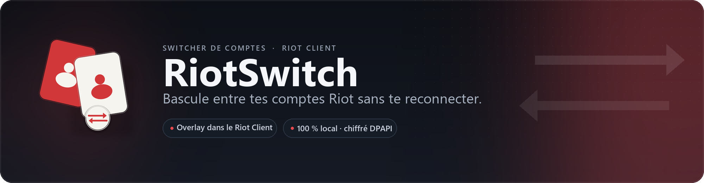
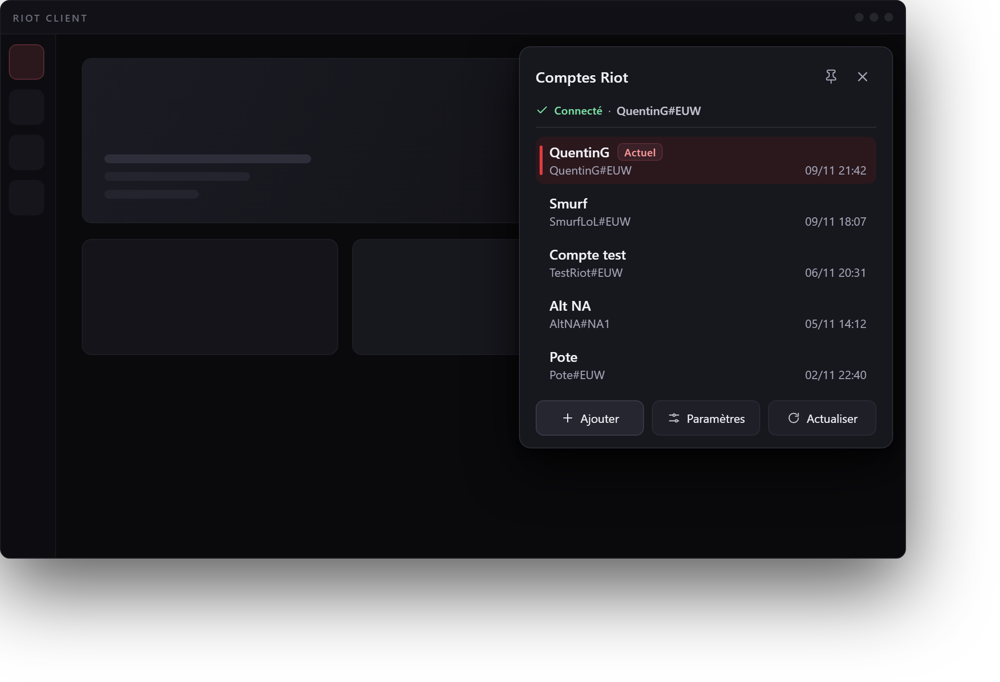
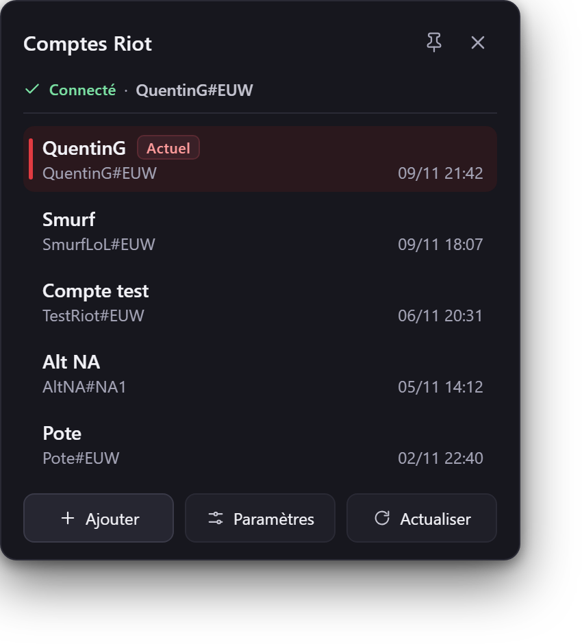
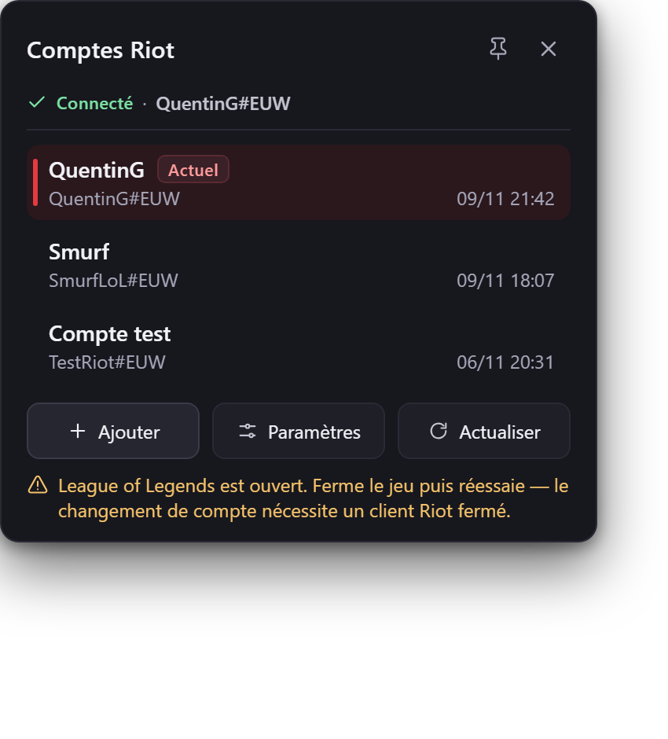
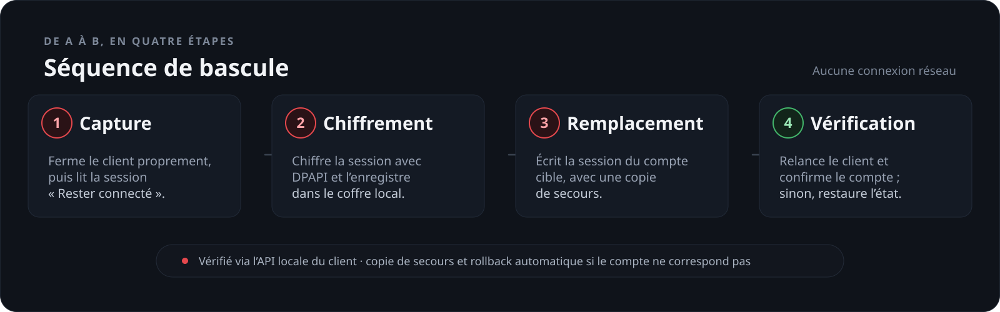

<p align="center">
  
</p>

<p align="center">
  <a href="https://github.com/quentingimenez/RiotSwitch/actions/workflows/ci.yml"></a>
  <a href="https://github.com/quentingimenez/RiotSwitch/releases"></a>
  
  
</p>

<p align="center">
  <b>Un overlay discret posé sur le Riot Client, et tes comptes Riot sont à un clic.</b>
</p>

> [!WARNING]
> Projet personnel, non officiel et **non affilié à Riot Games**. RiotSwitch réutilise les sessions locales que tu as créées normalement dans le Riot Client : il ne stocke ni mot de passe ni code d'authentification. À utiliser avec tes propres comptes, sur ta propre machine.

## Aperçu

<p align="center">
  
</p>

| Tes comptes, en un coup d'œil | Des messages clairs, jamais bloquants |
| --- | --- |
|  |  |

## Ce qu'il fait

- **Un bouton discret** en haut à droite de la fenêtre du Riot Client, qui ne vole jamais le focus au jeu.
- **Tous tes comptes** dans un panneau compact : le compte connecté, les autres, et leur dernière utilisation.
- **Bascule en un clic** : fermeture propre, session remplacée, client relancé, puis **compte réellement connecté vérifié** via l'API locale — sinon, rollback automatique.
- **Sans mot de passe** : seules les sessions locales sont conservées, chiffrées avec DPAPI pour ton compte Windows.
- **Tous les jeux Riot** — League of Legends, VALORANT, etc. — et un seul Riot Client à la fois.
- **100 % local** : aucune télémétrie, aucune session envoyée sur Internet.

## Installation

| Tu veux… | Télécharge… | À savoir |
| --- | --- | --- |
| **Le plus simple** | `RiotSwitch-Setup-x64.exe` | Installation par utilisateur, sans droits administrateur, avec désinstalleur propre. |
| **Une version portable** | `RiotSwitch-win-x64.exe` | ~64 Mo, runtime .NET inclus. Pas de mise à jour automatique. |
| **L'archive classique** | `RiotSwitch-win-x64.zip` (+ `.sha256`) | Nécessite le [.NET 8 Desktop Runtime](https://dotnet.microsoft.com/download/dotnet/8.0). |

Tout est sur la [dernière release](https://github.com/quentingimenez/RiotSwitch/releases). Détails, vérification du SHA-256, build depuis les sources : [guide utilisateur →](docs/utilisation.fr.md#installation).

## Prise en main

1. Lance RiotSwitch : le veilleur reste discret en arrière-plan et affiche l'overlay dès que le Riot Client apparaît.
2. Ouvre le Riot Client et connecte-toi à un premier compte.
3. Clique sur le bouton **⇄** en haut à droite du client, puis sur **+ Ajouter le compte actuel**.
4. Déconnecte-toi, connecte-toi à un second compte, ajoute-le. C'est prêt : un clic sur une ligne suffit pour basculer.

> Le premier ajout se fait **depuis chaque compte**, une fois connecté : RiotSwitch capture une session existante, il ne fabrique rien à partir d'un mot de passe.

## Comment ça marche

Le Riot Client garde la session « rester connecté » dans un unique fichier YAML local. RiotSwitch en capture une copie par compte, la chiffre avec DPAPI et la remplace quand tu changes de compte — sans jamais modifier les exécutables ni contourner l'authentification de Riot.

<p align="center">
  
</p>

Si la session d'un compte a expiré, le client reste sur son écran de connexion : reconnecte-toi une fois, puis réenregistre le compte. Fonctionnement interne détaillé : [architecture →](docs/architecture.fr.md).

## Performances

Mesures du 2026-11-11 sur Windows 11 (16 cœurs), binaire v1.1.17 puis **optimisations ÷2** (détails au [§13 du rapport](docs/perf/rapport-performance.fr.md)) :

| État | CPU moyen | Mémoire de travail |
| --- | --- | --- |
| Veilleur `--watch`, sans overlay | ≈ 0,04–0,05 % d'un cœur (0 % affiché) | 14–18 Mo après compactage (commit ≈ 15–17 Mo) |
| Overlay replié visible | ≈ 0,01 % d'un cœur | ≈ 21–23 Mo |
| Panneau déplié | ≤ 0,05 % d'un cœur | ≈ 30–31 Mo |

- **Réactivité** : overlay visible en ~65–80 ms après le passage au premier plan ; suivi des déplacements du client Riot en 1,5–3,4 ms ; déplier/replier ≈ 76 ms au total (dont 60 ms de maintien de l'outil de mesure ; rendu < 0,5 ms).
- **Cycles** : la fenêtre d'overlay est réutilisée (plus de destruction/recréation) — disparition ≈ 30 ms après minimisation du client, retour 73–99 ms ; déplier/replier ≈ 9–14 ms de CPU.
- **Démarrage à froid** : ≈ 62–64 Mo avant compactage, puis ~9 Mo de working set après le trim automatique (~2 s).
- **Optimisations** : CPU du veilleur ÷2,5 à ÷5, overlay et interactions ÷2, croissance mémoire des cycles supprimée ; ÷2,7 à ÷3,4 en usage réel (comparaison v1.1.17 → build optimisé au §13).

Méthode, chiffres détaillés et comparaison aux valeurs annoncées : [rapport de campagne](docs/perf/rapport-performance.fr.md) (recoupé par une [vérification indépendante](docs/perf/verification.fr.md) pour la version 1.1.17).

## Ligne de commande

RiotSwitch s'utilise aussi en script : `--watch`, `--launch-riot`, `--launch-riot --ephemeral`, `--settings`, `--attach`, `--version`. Un CLI de diagnostic (`RiotSwitch.Cli.exe list`, `status`, `doctor`, `window`, `capture`, `switch`, `restore`, `update`) aide au dépannage. Toutes les options et les codes de sortie : [guide utilisateur →](docs/utilisation.fr.md#ligne-de-commande).

## Données et confidentialité

- Tout vit dans `%LOCALAPPDATA%\RiotSwitch` : sessions chiffrées (`.rsw`), sauvegardes, journaux et réglages.
- Les sessions sont protégées par **DPAPI** (compte Windows courant) ; le fichier live du Riot Client, lui, reste en clair comme sans RiotSwitch.
- Aucun mot de passe, code OTP ou jeton brut : RiotSwitch relit le fichier de session que le Riot Client écrit lui-même.

## Limites

- **Pas de switch pendant une partie** : RiotSwitch refuse tant qu'une partie League of Legends, VALORANT, etc. est en cours.
- **Session expirée** : aucune session n'est recréée ; le client reste sur l'écran de connexion, à toi de te reconnecter puis de réenregistrer le compte.
- **Mises à jour Riot** : un nouveau format de session peut casser temporairement la capture ; RiotSwitch refuse d'écrire un format inconnu plutôt que de risquer un fichier incohérent.
- **Client élevé** : si le Riot Client tourne en administrateur, lance RiotSwitch avec les mêmes droits.

## Documentation

| Document | Contenu |
| --- | --- |
| [Guide utilisateur](docs/utilisation.fr.md) | Installation, premier lancement, overlay, CLI, mises à jour, dépannage. |
| [Architecture](docs/architecture.fr.md) | Fonctionnement interne, coffre DPAPI, séquence de switch. |
| [Validation](docs/validation.fr.md) | Checklist des tests et des releases, jusqu'à la v1.1.17. |
| [Performances](docs/perf/rapport-performance.fr.md) | Mesures de campagne (veilleur, overlay, interactions) et vérification indépendante. |
| [Spec de l'overlay](docs/overlay-ui/spec-overlay.fr.md) | Design tokens, composants, captures de la maquette. |

## Développement

```powershell
dotnet build RiotSwitcher.sln
dotnet test tests\RiotSwitcher.Core.Tests\RiotSwitcher.Core.Tests.csproj
powershell -ExecutionPolicy Bypass -File tools\publish.ps1
```

Le script de publication assemble `dist\` : application, CLI, README et documentation. C# / .NET 8, overlay WinForms rendu en GDI+, aucun paquet tiers.

## Avertissement

RiotSwitch n'est pas un produit Riot Games et n'est pas approuvé par Riot. Le partage de compte et certaines automatisations sont encadrés par les conditions d'utilisation de Riot : ce projet est prévu pour basculer entre **tes propres comptes**, sur **ta propre machine**, sans contourner l'authentification. En cas de doute, vérifie les conditions applicables à ton pays.
